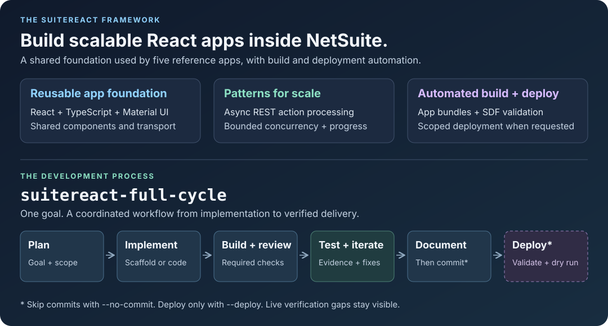

# SuiteReact MCP

### Custom React apps. Native NetSuite runtime. An agent workflow you can review.

Build the interface your NetSuite users need with **React and TypeScript**, iterate locally, and ship it as a **NetSuite Suitelet**. Give your coding agent account-aware tools and reusable skills to take a plain-language goal through implementation and verification.

[Quick start](#quick-start) · [Build with an agent](#agent-skills-and-workflows) · [Explore the apps](#reference-applications) · [Setup guide](docs/setup.md) · [Contributing](CONTRIBUTING.md)



**React + TypeScript · Vite · Material UI · SuiteScript 2.1 · MCP · BSD-3-Clause**

## Why SuiteReact?

| What you need                           | What SuiteReact provides                                                                                                                                        |
| --------------------------------------- | --------------------------------------------------------------------------------------------------------------------------------------------------------------- |
| A custom interface inside NetSuite      | React components and MUI layouts served by a Suitelet, with SuiteScript actions running under the caller's role. No separate frontend hosting service required. |
| Fast iteration against account data     | The same client transport works through a local authenticated proxy during development and through a RESTlet in NetSuite.                                       |
| An agent that can check its assumptions | MCP tools for live Record Catalog metadata, SuiteQL guidance and execution, framework examples, and scaffolding.                                                |
| Changes your team can maintain          | Portable skills that plan, track file ownership, build, review, and test, with explicit deployment and recorded verification gaps.                              |

Use the **framework**, the **MCP tools**, or the **skills** independently. You can build apps without a coding agent, and use the query tools without deploying an app. An MCP-compatible client is required only for agent tools; an OpenAI API key is optional for knowledge retrieval.

## Quick start

**Requirements:** Node.js **22** (the CI baseline; packages support 22+) and npm **10+**. Use a Bash-capable terminal for the managed development and deployment commands.

Clone or download this repository using its **Code** menu, then open a terminal in the repository root:

```bash
npm ci
npm run setup
npm run doctor
npm run build:app -- data-viewer
```

**Success looks like:** Doctor reports that the build checks passed, and the app build creates `apps/data-viewer/client/` and copies it to `dist/FileCabinet/SuiteScripts/apps/data-viewer/client/`.

This path needs **no NetSuite account, Java, SuiteCloud CLI, or AI API key**. Setup creates ignored configuration templates and a shared local proxy token; it preserves existing values and tightens file permissions. The build checks TypeScript, lint, and the production bundle. It writes local files only, even where its output says “Deployed to.”

<details>
<summary><strong>Preview the interface locally</strong></summary>

```bash
npm run dev -- data-viewer
```

Open the `vite.url` printed by the runner, normally `http://127.0.0.1:5173`. This starts the frontend only. Reference apps need a configured account and live proxy to load records; an empty or error state is not a connected demo.

```bash
npm run dev:stop -- data-viewer
```

</details>

### Choose your next step

| I want to…                             | Follow this path                                                             | Additional setup                                                                |
| -------------------------------------- | ---------------------------------------------------------------------------- | ------------------------------------------------------------------------------- |
| Build an app with my coding agent      | [Agent skills and workflows](#agent-skills-and-workflows)                    | Register MCP and load the repo's skills                                         |
| Browse or query NetSuite from my agent | [MCP server](#mcp-server)                                                    | OAuth 2.0 integration and an authorized account role                            |
| Run an app with live NetSuite data     | [Live app setup](docs/setup.md#3-run-an-app-against-live-netsuite-data)      | TBA credentials and the shared backend installed in a sandbox                   |
| Install into a new NetSuite account    | [Sandbox bootstrap](docs/setup.md#2-prepare-a-sandbox-for-live-applications) | SuiteCloud CLI, Java, and a reviewed installation of shared scripts and objects |
| Validate and deploy an app change      | [Build, validate, and deploy](#build-validate-and-deploy)                    | Configured target account and exact deployment scope                            |

## Agent skills and workflows

The **tools** provide NetSuite and framework capabilities. The **skills** define how the agent uses them: plan first, make a scoped change, verify it, and report the evidence.

1. [Connect the MCP server](#mcp-server) to your coding client.
2. Use the skills in [`.agents/skills/`](.agents/skills/), the canonical source for all 14 workflows. Compatible clients discover them from the checkout; other clients can use an [installation adapter](docs/setup.md#install-or-refresh-agent-skills). Load companion skills from the same checkout.
3. Invoke `suitereact-full-cycle` with an app name and a concrete goal. Adapt the invocation syntax to your client:

```text
/suitereact-full-cycle customer-hub "Build a read-only customer explorer with search, pagination, and a record details panel. Verify the account fields before implementing live queries." --no-commit
```

The workflow produces:

- **A plan and owned-file list** so the change has a clear scope.
- **Build, review, and test evidence** selected for the kind of change: new app, UI, server action, or shared library.
- **A working app or an explicit blocker**, including any missing live-account verification.

`--no-commit` leaves the change available for inspection. Without it, the skill can create a local commit; it never pushes automatically. Deployment requires an explicit `--deploy <environment>` request. Skills guide the agent; the scripts and tests provide the checks.

<details>
<summary><strong>Workflow options and individual skills</strong></summary>

```text
suitereact-full-cycle <app-name> <goal>
  [--no-commit] [--strict] [--target-branch <branch>]
  [--deploy <environment>]
```

| Task                  | Skills                                                                                                   |
| --------------------- | -------------------------------------------------------------------------------------------------------- |
| Plan and implement    | `suitereact-full-cycle`, `suitereact-scaffold`, `suitereact-code`                                        |
| Run and verify        | `suitereact-dev`, `suitereact-review`, `suitereact-test`, `suitereact-test-action`, `suitereact-analyze` |
| Deliver               | `suitereact-commit`, `suitereact-deploy`                                                                 |
| Work with Doc Spaces  | `doc-spaces-author`, `doc-spaces-publish`, `doc-spaces-search`                                           |
| Write SuiteQL queries | [suiteql-cookbook](.agents/skills/suiteql-cookbook/SKILL.md)                                             |

The canonical local record is `.workflows/<app>/<workflow-id>/workflow.json`. It tracks ownership, checks, live evidence, and delivery state and is ignored by Git. See the [full-cycle skill](.agents/skills/suitereact-full-cycle/SKILL.md) and [workflow contract](.agents/skills/suitereact-full-cycle/references/workflow-contract.md).

**Updating installed skills?** Update the checkout before starting a new session. [`link-skills.sh`](link-skills.sh) links the set into one discovery directory and migrates this checkout's old Cursor/Codex links when using its default destination. It preserves copied or unrelated installations and reports conflicts. See [refresh instructions](docs/setup.md#install-or-refresh-agent-skills) to avoid an older global copy shadowing the checkout.

</details>

## Reference applications

Five apps show the framework in use. Start with **Data Viewer** for record browsing; use the others for patterns that match your workflow.

| App                                                 | What it does                                            | Patterns to reuse                                        |
| --------------------------------------------------- | ------------------------------------------------------- | -------------------------------------------------------- |
| [Data Viewer](apps/data-viewer/README.md)           | Explore customers, transactions, and employees          | Account metadata, filters, keyset pagination, CSV export |
| [Approval Manager](apps/approval-manager/README.md) | Process transaction approvals in bulk                   | Selection, progress, error reporting, approval history   |
| [SuiteQL Bot](apps/suiteql-bot/README.md)           | Write, run, and explore SuiteQL with an AI assistant    | Query editor, structured responses, result grids         |
| [Invoice PDF](apps/invoice-pdf/README.md)           | Generate invoice PDFs and download a ZIP                | Server rendering, batching, per-record failures          |
| [Doc Spaces](apps/doc-spaces/README.md)             | Publish and organize HTML documentation inside NetSuite | Spaces, document permissions, editor and live preview    |

These apps use account data and permissions. Approval actions write to NetSuite; AI features require separately configured providers. Review each app before enabling it for users.

## Architecture

**Local development:** React → authenticated loopback proxy → NetSuite RESTlet.

**Inside NetSuite:** Suitelet serves the built React bundle → shared RESTlet → SuiteScript actions.

**Agent tools:** MCP client → local stdio MCP server → packaged guidance or authenticated NetSuite APIs.

Apps call named actions through `handleRestletAction`; the transport selects the runtime. The local app proxy uses **OAuth 1.0 Token-Based Authentication**. The MCP server uses **OAuth 2.0 with PKCE**. These are separate configurations; connecting one does not authenticate the other.

### SuiteReact library

The [`suitereact/`](suitereact/README.md) package supplies the shared transport, toast services, typed Data Grid helpers, and reusable components such as `NsReactDataGrid`, `NsReactButton`, and `NsReactChatbot`. Apps own their layouts and domain logic using ordinary React and Material UI.

## MCP server

After the quick start, build the server:

```bash
npm run build:mcp
```

Add a stdio server to your MCP client. Replace the absolute path below; the surrounding configuration format depends on the client.

```json
{
  "mcpServers": {
    "suitereact-mcp": {
      "command": "node",
      "args": ["/absolute/path/to/suitereact-mcp/mcp/dist/index.js"]
    }
  }
}
```

**Check the connection:** ask for a SuiteReact code sample. Packaged guidance and scaffolding work without NetSuite login or an OpenAI key. To query account data, [configure OAuth and role permissions](docs/setup.md#4-enable-mcp-tools), then use `suiteql_query_assistant` before `execute_suiteql_query`.

The first account-backed call starts browser authentication when needed; server startup itself does not. Use `mcp_auth` to retry a failed login or `mcp_reauth` to replace an invalid session. Configure Doc Spaces separately before using its publishing tools.

See the [MCP reference](mcp/README.md) for tools, resources, and optional semantic retrieval. Rebuild and restart the MCP server after changing its code or packaged resources. Updating a Markdown skill alone does not require an MCP rebuild.

## Local development

Once the [sandbox backend and local credentials are configured](docs/setup.md#3-run-an-app-against-live-netsuite-data):

```bash
npm run doctor -- --live --app data-viewer
npm run dev -- data-viewer --live
```

Open the reported `vite.url`. The runner manages the frontend and proxy, checks RESTlet readiness, and selects another Vite port if 5173 is occupied.

| Command                             | Purpose                                                     |
| ----------------------------------- | ----------------------------------------------------------- |
| `npm run dev:status -- data-viewer` | Inspect the managed frontend and proxy                      |
| `npm run dev:stop -- data-viewer`   | Stop processes owned by that app session                    |
| `npm run build:app -- data-viewer`  | Check and build one app locally                             |
| `npm run build`                     | Build the library, shared scripts, MCP, all apps, and proxy |

Use `apps/<app>/.env.development.local` for local proxy settings. Keep development-only reads behind `import.meta.env.DEV`; production builds reject embedded loopback URLs and proxy configuration.

## Testing and review

```bash
npm run review:app -- data-viewer
npm run check
```

`review:app` performs static application checks. `check` runs the repository's automated quality pipeline; it does not prove that an account's roles or deployments are correctly configured.

For browser smoke tests, install Chromium once, then use the managed wrapper:

```bash
npx playwright install chromium
npm run dev:test -- data-viewer -- npm run test:app -- data-viewer
```

This is a frontend smoke run. Add `--live` to **both** commands only after live setup is complete. App-specific smoke tests belong in `apps/<app>/test/smoke.mjs`.

**Changed server code needs current server evidence.** A response from an older deployed RESTlet does not validate a local change. See [testing and evidence rules](docs/testing.md) for direct action tests, workflow artifacts, and live verification.

## Build, validate, and deploy

**Builds stay local. Deployments change the selected NetSuite account.** A new account first needs the [shared backend installation](docs/setup.md#2-prepare-a-sandbox-for-live-applications); deploying an app alone does not install it.

With SuiteCloud configured for the intended sandbox and the exact `deploy.override` reviewed:

```bash
npm run doctor -- --deploy
npm run validate:app -- data-viewer
```

Validation builds the app and SDF artifacts, checks the production bundle and deployment scope, and runs SuiteCloud server validation and a dry run. An existing `deploy.override` is reused; inspect it before switching apps or targets.

After reviewing the validation results and approving the target account:

```bash
npm run deploy:app -- data-viewer
```

Deployment reruns validation. Shared files and SDF objects must be explicitly enumerated; broad shared wildcards are rejected. Account installation and application updates have separate setup steps in the [deployment guide](docs/setup.md#5-validate-or-deploy-later-changes).

## Security and change control

- **Configure roles before enabling entry points.** Public Suitelets and RESTlets ship disabled with no default audience. Keep caller-role execution and configure separate query, mutation, and LLM allowlists.
- **Install Doc Spaces controls before exposing the app.** Its backing records require native permissions and an active record guard. Follow the [security setup and sandbox checks](docs/doc-spaces-security.md).
- **Keep credentials server-side.** Local environment files and OAuth tokens stay out of Git. Production AI credentials belong in NetSuite API secrets.
- **Treat account access as real access.** Native role permissions determine which data a tool or action can reach. Test allowed and denied roles in your own sandbox.

Production rollout and public publication require the checks and approvals in [RELEASE.md](RELEASE.md). Report vulnerabilities through [SECURITY.md](SECURITY.md).

## Documentation

| Guide                                                  | Use it for                                                                         |
| ------------------------------------------------------ | ---------------------------------------------------------------------------------- |
| [Setup and troubleshooting](docs/setup.md)             | Account-free builds, sandbox installation, authentication, and connection failures |
| [MCP reference](mcp/README.md)                         | Tool parameters and knowledge resources                                            |
| [Component library](suitereact/README.md)              | Shared React APIs                                                                  |
| [App quality checklist](docs/app-quality-checklist.md) | Reviewing a new or changed app                                                     |
| [Performance](docs/performance.md)                     | Query, React, Data Grid, and SuiteScript constraints                               |
| [Testing](docs/testing.md)                             | Browser tests, direct actions, and honest live evidence                            |
| [Contributing](CONTRIBUTING.md)                        | Development and pull-request expectations                                          |
| [Release process](RELEASE.md)                          | Package and production release gates                                               |
| [Changelog](CHANGELOG.md)                              | Release-facing changes                                                             |

<details>
<summary><strong>Project structure</strong></summary>

```text
apps/           Reference apps and your new apps
suitereact/     Shared React components, hooks, and transport
mcp/            Local MCP server and packaged knowledge
server/         Local authenticated proxy
sdf/            SuiteScript source and SDF objects
deploy/         Build, development, test, and deployment commands
docs/           Setup and engineering guides
.agents/skills/ Portable agent workflows
.cursor/rules/  Framework conventions
.workflows/     Local verification evidence (ignored)
```

See [source provenance](docs/source-provenance.md) for generated-artifact policy and [third-party notices](THIRD_PARTY_NOTICES.md) for dependency and vendored-source attribution.

</details>

## License

[BSD-3-Clause](LICENSE).
